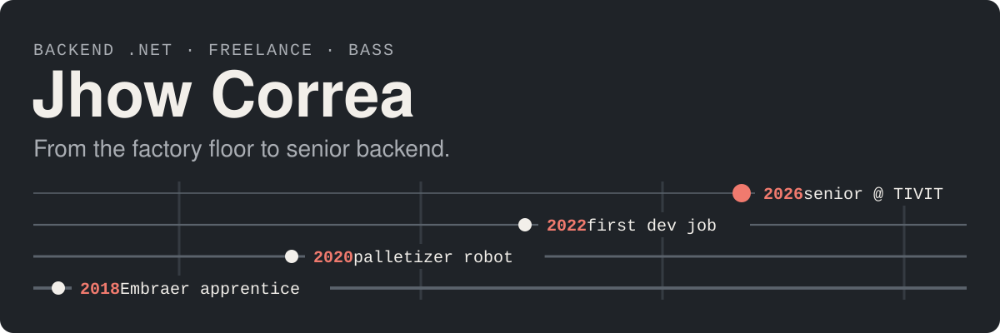

<picture>
  <source media="(prefers-color-scheme: light)" srcset="./assets/readme/hero-en-light.svg">
  
</picture>

**English** | [Português (BR)](README.pt-BR.md)

Hey, I'm Jhow 🤘🏽 Senior backend dev (**.NET / C#**) at TIVIT.

I didn't start in tech. I was an electronics apprentice at Embraer, then ran a palletizer robot on a dairy production line, and in 2022 I traded that line for one made of code. Since then: microservices for an airline, ERP integrations, Open Finance and PIX for a bank, and now dashboards and critical apps in production.

Off the clock I build sites and small systems for local businesses, play bass, and put Claude Code to work on everything repetitive. When something proves useful, it ends up public here.

### What I'm building in public

**Claude Code, in Portuguese**
- [**raio-x-github**](https://github.com/CorreaJhow/raio-x-github): an X-ray of your GitHub profile. Security audit, a score, and a script you review before running.
- [**skills-br**](https://github.com/CorreaJhow/skills-br): the skills I actually use day to day (debugging, verification, handoff, SEO, study), free and tested.

**.NET, studied out loud**
- [**dotnet-na-pratica**](https://github.com/CorreaJhow/dotnet-na-pratica): .NET and C# concepts with code that runs and gets measured.
- [**csharp-15-na-pratica**](https://github.com/CorreaJhow/csharp-15-na-pratica): every C# 15 / .NET 11 feature as an example that compiles, with a real-life scenario.

**Stuff that runs in the real world**
- [**tp-flame-organization**](https://github.com/CorreaJhow/tp-flame-organization) · [demo](https://tp-flame-organization.vercel.app): chord sheets and setlists for a worship team. Works offline on stage, transposes key, syncs via Google Sheets.
- [**FotoPrint**](https://github.com/CorreaJhow/FotoPrint): instant photo printing at events. Guests upload from their phone, the printer spits it out. Blazor Server.

### Recently touched
Updated every day by a GitHub Action.

<!-- RECENTES:INICIO -->
- [**raio-x-github**](https://github.com/CorreaJhow/raio-x-github): Skill do Claude Code em PT-BR que faz um raio-x do seu GitHub: auditoria de segurança, nota e script revisável · Nov 25, 2026
- [**tp-flame-organization**](https://github.com/CorreaJhow/tp-flame-organization): PWA de cifras e repertório pra equipe de louvor: offline no palco, transposição de tom e sync via Google Sheets · Nov 25, 2026
- [**dotnet-na-pratica**](https://github.com/CorreaJhow/dotnet-na-pratica): Conceitos do .NET e C# com exemplo que roda e medido, em PT-BR. Estudo em público. · Nov 21, 2026
- [**skills-br**](https://github.com/CorreaJhow/skills-br): Skills do Claude Code em português: debug, verificação, handoff, SEO e estudo. Grátis, testadas. · Nov 19, 2026
<!-- RECENTES:FIM -->

### Day to day
`C#` `.NET` `ASP.NET Core` `EF Core` `SQL Server` `MongoDB` `Azure DevOps` `TypeScript` `React` `Next.js` `Tailwind` `Claude Code` `GitHub Actions`
