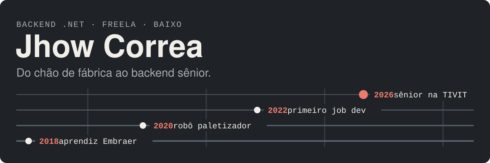

<picture>
  <source media="(prefers-color-scheme: light)" srcset="./assets/readme/hero-pt-light.svg">
  
</picture>

[English](README.md) | **Português (BR)**

Opa, bem demais? Eu sou o Jhow 🤘🏽 Dev backend sênior (**.NET / C#**) na TIVIT.

Não comecei na tecnologia. Fui aprendiz de eletroeletrônica na Embraer, operei robô paletizador numa linha de produção de laticínios e em 2022 troquei essa linha pela de código. De lá pra cá: microsserviços pra companhia aérea, integração de ERP, Open Finance e PIX pra banco e, hoje, painel gerencial e sustentação de aplicação crítica em produção.

Fora do expediente faço site e sistema pequeno pra negócio local, toco baixo e coloco o Claude Code pra trabalhar em tudo que é repetitivo. O que se prova útil acaba público aqui.

### O que tô construindo em público

**Claude Code em português**
- [**raio-x-github**](https://github.com/CorreaJhow/raio-x-github): raio-x do seu perfil do GitHub. Auditoria de segurança, nota e um script que você revisa antes de rodar.
- [**skills-br**](https://github.com/CorreaJhow/skills-br): as skills que eu uso de verdade no dia a dia (debug, verificação, handoff, SEO, estudo), grátis e testadas.

**.NET estudado em voz alta**
- [**dotnet-na-pratica**](https://github.com/CorreaJhow/dotnet-na-pratica): conceitos de .NET e C# com código que roda e é medido.
- [**csharp-15-na-pratica**](https://github.com/CorreaJhow/csharp-15-na-pratica): cada novidade do C# 15 / .NET 11 num exemplo que compila, com cenário do dia a dia.

**Coisa que roda no mundo real**
- [**tp-flame-organization**](https://github.com/CorreaJhow/tp-flame-organization) · [demo](https://tp-flame-organization.vercel.app): cifras e repertório pra equipe de louvor. Funciona offline no palco, transpõe o tom e sincroniza pelo Google Sheets.
- [**FotoPrint**](https://github.com/CorreaJhow/FotoPrint): impressão instantânea de fotos em evento. O convidado manda pelo celular, a impressora solta. Blazor Server.

### Mexi recentemente
Atualizado todo dia por uma GitHub Action.

<!-- RECENTES:INICIO -->
- [**raio-x-github**](https://github.com/CorreaJhow/raio-x-github): Skill do Claude Code em PT-BR que faz um raio-x do seu GitHub: auditoria de segurança, nota e script revisável · 25/11/2026
- [**tp-flame-organization**](https://github.com/CorreaJhow/tp-flame-organization): PWA de cifras e repertório pra equipe de louvor: offline no palco, transposição de tom e sync via Google Sheets · 25/11/2026
- [**dotnet-na-pratica**](https://github.com/CorreaJhow/dotnet-na-pratica): Conceitos do .NET e C# com exemplo que roda e medido, em PT-BR. Estudo em público. · 21/11/2026
- [**skills-br**](https://github.com/CorreaJhow/skills-br): Skills do Claude Code em português: debug, verificação, handoff, SEO e estudo. Grátis, testadas. · 19/11/2026
<!-- RECENTES:FIM -->

### No dia a dia
`C#` `.NET` `ASP.NET Core` `EF Core` `SQL Server` `MongoDB` `Azure DevOps` `TypeScript` `React` `Next.js` `Tailwind` `Claude Code` `GitHub Actions`
